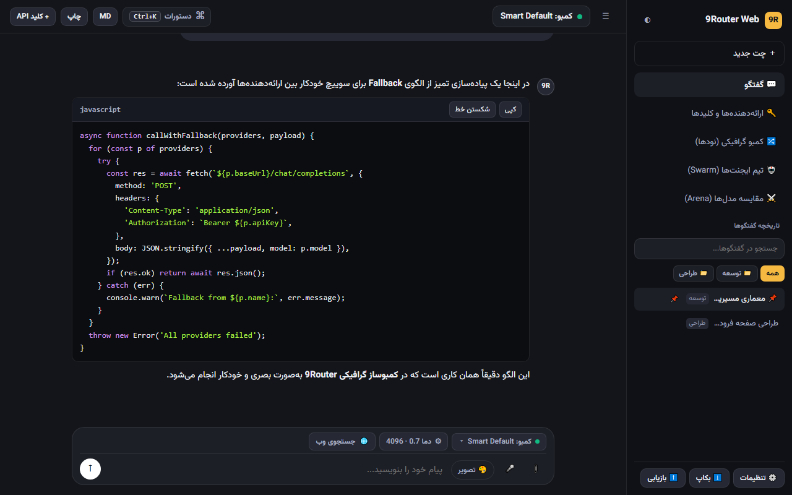
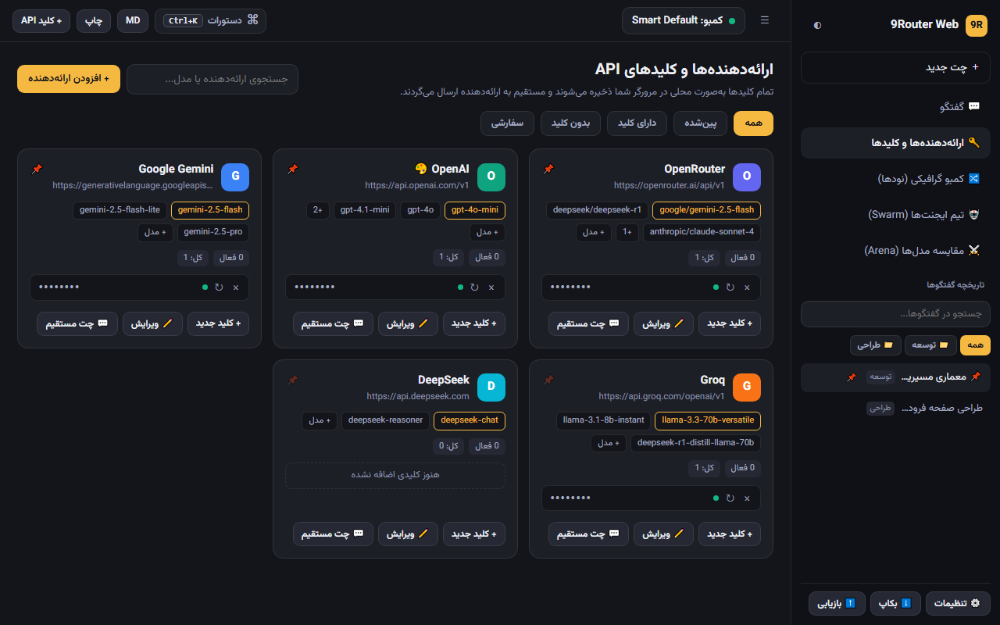
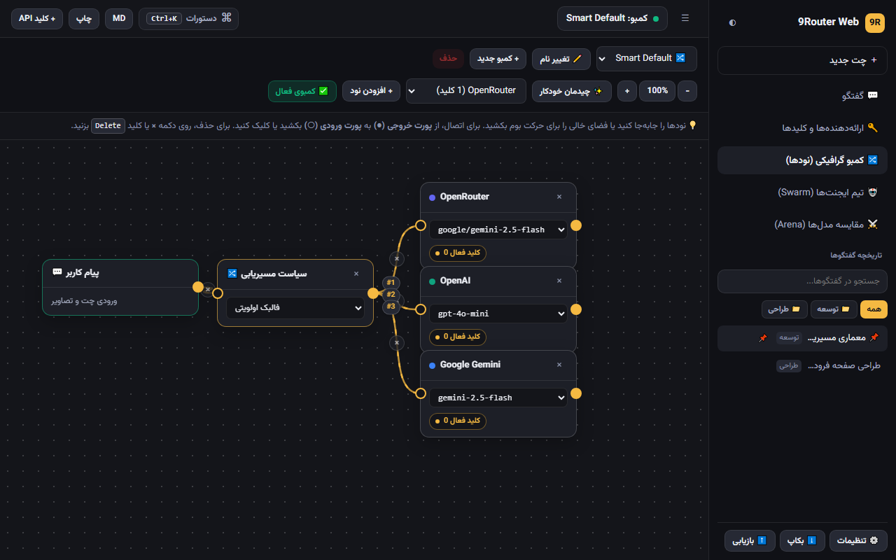
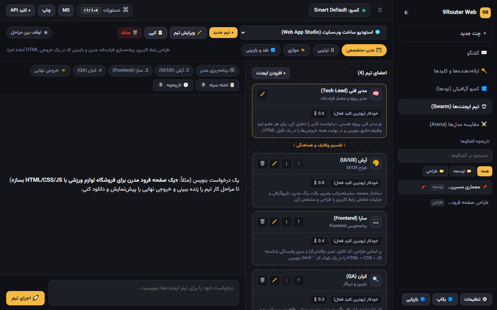

# 9Router Web ⚡

**نسخه زنده (Live Demo):** [https://mohsen-niksirat.github.io/9router/](https://mohsen-niksirat.github.io/9router/)

اپلیکیشن وب **۱۰۰٪ استاتیک (آماده برای GitHub Pages)** با رویکرد **BYOK (Bring Your Own Key)** برای مدیریت چند ارائه‌دهنده هوش مصنوعی، مسیریابی گرافیکی مدل‌ها، اجرای تیم‌های چندایجنتی و مقایسه مدل‌ها — بدون نیاز به سرور واسط یا Build!

---

## پیش‌نمایش محیط برنامه

| محیط گفتگو (Chat & Reasoning) | مرکز ارائه‌دهنده‌ها و کلیدها (Providers & Keys) |
| :---: | :---: |
|  |  |

| کمبوساز گرافیکی (Visual Combo Graph) | استودیو تیم ایجنت‌ها (Team Studio) |
| :---: | :---: |
|  |  |

---

## ویژگی‌ها

### 💬 محیط چت مدرن شبیه ChatGPT
- **استریم زنده (SSE):** دریافت پاسخ‌ها به‌صورت لحظه‌ای همراه با دکمه توقف تولید (`AbortController`).
- **نمایش فرایند تفکر (Reasoning):** نمایش تاشو و خوانای `reasoning_content` برای مدل‌های استدلالی.
- **پشتیبانی از تصویر (Vision + تولید و ویرایش عکس):** پیوست تصویر برای تحلیل (Vision)، به همراه تولید و ویرایش تصویر مستقیم در چت (`/images/generations` و `/images/edits`) و **فالبک رایگان Pollinations** در صورت نبود کلید تصویرساز.
- **مدیریت پیشرفته گفتگوها:** جستجو در سشن‌ها، **پوشه‌بندی (Folders)**، **سنجاق کردن (Pin)**، **انشعاب‌گیری از گفتگو (Fork)**، رندر Markdown و بلوک کد با دکمه کپی، و تم دارک/لایت.
- **پنل Artifacts:** نمایش و پیش‌نمایش جداگانه خروجی‌های کد/محتوا در کنار چت.
- **خروجی گرفتن از گفتگو:** ذخیره مستقیم گفتگو به فرمت **Markdown (`.md`)** و **HTML قابل چاپ / PDF**.

### 🔑 مرکز یکپارچه ارائه‌دهنده‌ها و کلیدها (Providers & Keys Hub)
- پشتیبانی از ارائه‌دهندگان آماده (OpenRouter، OpenAI، Google Gemini، Groq، DeepSeek) و امکان افزودن ارائه‌دهنده سفارشی (OpenAI-Compatible).
- **دریافت آنلاین لیست مدل‌ها (`/models`):** بارگذاری مستقیم مدل‌های در دسترس از API ارائه‌دهنده همراه با **انتخابگر قابل جستجو (Searchable Picker)**.
- **انتخاب دقیق هدف (Provider + Model + Key):** مدیریت چند کلید API برای هر ارائه‌دهنده با نمایش ماسک‌شده و انتخاب دقیق ترکیب ارائه‌دهنده، مدل و کلید.

### 🔀 کمبوساز گرافیکی (Visual Combo Graph)
- طراحی بصری زنجیره مسیریابی (`پیام کاربر ← سیاست مسیریابی ← ارائه‌دهنده‌ها`) با **اتصال درگ/کلیک (Drag & Click Connect)** و حذف اتصال‌ها.
- **تنظیم مدل اختصاصی برای هر نود (Per-Node Model)**، چیدمان خودکار (**Auto-Layout**)، و بزرگ‌نمایی/جابه‌جایی بوم (**Zoom & Pan**).
- پشتیبانی از ۴ سیاست مسیریابی: **`Fallback`** (اولویتی)، **`Round-Robin`** (چرخشی)، **`Smart Router`** (هوشمند بر اساس سلامت نود) و **`Least Used`** (کمترین مصرف).

### 🤖 استودیو تیم ایجنت‌ها (Team Studio / Swarm)
- **۴ پیش‌تنظیم آماده (Presets)** برای شروع سریع به همراه امکان ساخت و ویرایش تیم‌های سفارشی.
- **۴ حالت اجرا (Execution Modes):**
  - `Manager-Worker` (مدیر-متخصص)
  - `Sequential` (ترتیبی)
  - `Parallel` (موازی)
  - `Debate & Review` (نقد و بازبینی چرخه‌ای)
- تنظیم مستقل **ارائه‌دهنده، مدل، کلید و دما (Temperature)** برای هر ایجنت.
- **تله‌متری زنده (Live Telemetry)**، **تخته اشتراکی (Shared Blackboard)**، قابلیت **توقف تعاملی بین مراحل (HITL Pause)** و **تاریخچه اجراها (Run History)**.

### ⚔️ مقایسه مدل‌ها (Arena)
- ارسال هم‌زمان یک پرامپت به چند مدل مختلف و مقایسه مستقیم کیفیت و سرعت پاسخ‌ها کنار هم.

### ⌘ ابزارهای بهره‌وری و جستجوی وب
- **پالت دستورات (`Ctrl+K`):** دسترسی سریع با کیبورد به تب‌ها، گفتگوها، مدل‌ها و اکشن‌های اصلی.
- **جستجوی وب با کلید شخصی (BYOK Web Search):** پشتیبانی از **Tavily**، **Serper** و **Brave Search** برای تزریق اطلاعات به‌روز وب به پاسخ مدل‌ها.
- **پشتیبان‌گیری رمزنگاری‌شده (Encrypted Backup):** بکاپ و بازیابی کامل تنظیمات، کلیدها، کمبوها و گفتگوها با رمزنگاری **AES-GCM + PBKDF2** (در کنار خروجی JSON ساده).

---

## حریم خصوصی و امنیت (Privacy Model)

- **ذخیره‌سازی صرفاً محلی:** تمام کلیدهای API، تاریخچه گفتگوها و تنظیمات شما فقط در `localStorage` مرورگر خودتان ذخیره می‌شوند و هیچ دیتابیس یا سرور میانی در کار نیست.
- **ارتباط مستقیم با ارائه‌دهنده:** درخواست‌ها مستقیماً از مرورگر شما به آدرس API ارائه‌دهنده انتخابی (یا سرویس جستجوی وب) ارسال می‌شوند.
- **توصیه برای بکاپ:** فایل بکاپ ساده (JSON معمولی) شامل کلیدهای API به‌صورت متن خوانا (clear text) است؛ برای نگهداری یا انتقال امن بین دستگاه‌ها، حتماً از گزینه **بکاپ رمزنگاری‌شده (AES-GCM + PBKDF2)** استفاده کنید.

---

## انتشار روی GitHub Pages

1. این پوشه را در یک ریپازیتوری GitHub پوش کنید.
2. در تنظیمات ریپازیتوری به **Settings → Pages** بروید، شاخه `main` و پوشه `/ (root)` را انتخاب و ذخیره کنید.
3. سایت بلافاصله بدون نیاز به Build روی `https://<username>.github.io/<repo>/` بالا می‌آید.
